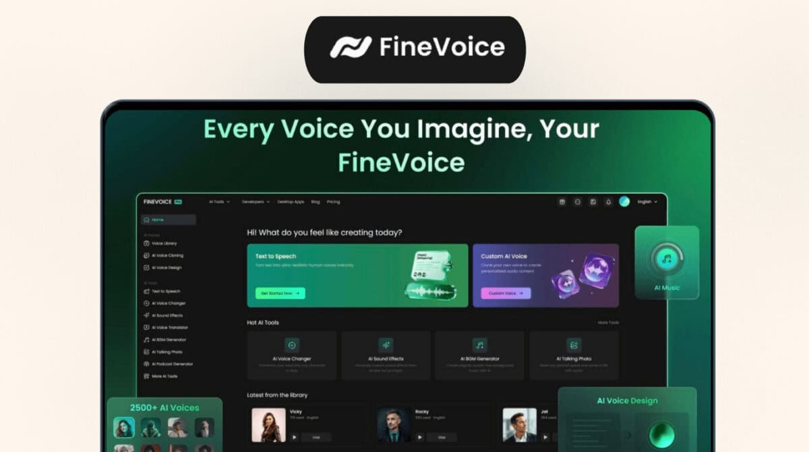
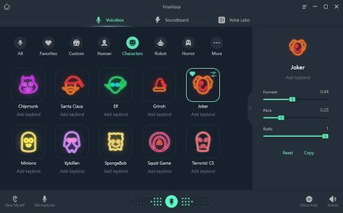
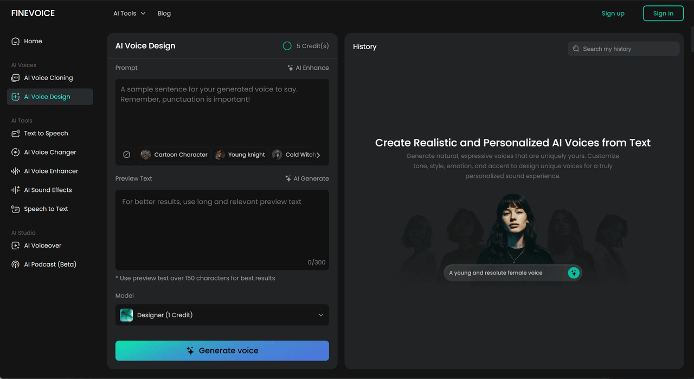

# FineVoice Fineshare

FineVoice Fineshare is the FineVoice desk for speech, cloned tone, and a live mic. FineVoice keeps a text line, a short reference clip, and the outgoing call in one account. You write a script, pick a voice, and send the result to a file or to a meeting.

finevoice software covers six jobs: text to speech, voice cloning, voice design, a real-time changer, sound effects, and speech to text. The finevoice ai voice changer is the live path. The finevoice voice changer is the same idea on a file you already recorded. Browser pages let you try a line before you install the desktop build.

This tree is the local companion for that product. It holds the speech model code, the text cleaners, and the client that streams a microphone to a conversion server. The pages below describe FineVoice Fineshare. The files are the pieces you open when you want to see how a line becomes audio.



## Introduction

FineVoice reads text and speaks it in a chosen voice. A catalog of more than 1,500 voices covers 154 languages and accents, so a product video and a support line can share one script in two regions. The browser is enough for a first test. The desktop build is the path for a daily mic.

A clone starts from about 30 seconds of a speaker. Voice design is the other door: you describe age, accent, emotion, and style in a prompt, and FineVoice builds a voice that did not exist as a recording. Both results sit in the same library as the stock voices.

[api.py](voice/api.py) defines `BaseSpeakerTTS` and `ToneColorConverter`. The first turns a normalized line into a base spectrogram. The second moves that spectrogram toward a target tone color. [openvoice_app.py](voice/openvoice_app.py) is the small app wrapper around that pair. [models.py](voice/models.py) builds `SynthesizerTrn`, the network both classes load from a checkpoint.

## What's New

The current FineVoice pass keeps the live changer and the file changer on one account. A clip you convert for a video uses the same voice as the mic you send to Discord, Zoom, or OBS. You do not keep a second login for the call.

Voice design prompts are saved with the voice, so a later session can rebuild the same age and accent instead of guessing the sliders again. Sound effects from a text prompt land in the same library as the speech takes. Speech to text is there when you need a transcript of a take you just rendered.

Paid seats raise the character cap and unlock the desktop app. The free seat stays on the browser with a shorter line. Details are in the editions table below.

A sound effect prompt is separate from a voice prompt. Ask for a door, a room, or a short sting, then drop the file under the voiceover. Speech to text runs the other way: you hand it a take and read the words back. Use that when a client wants the script that matches the audio you just delivered.

The online changer accepts a file upload when you are not on a call. The desktop changer owns the mic. Switching between them does not create a second voice. The library id stays the same, so a thumbnail in the browser and a device in the desktop app point at one entry.

## Editions

FineVoice Fineshare sells the same editor at two depths. The free seat is for a trial line. The upgraded seat is for a real script and for the desktop mic.

| Seat | Characters per conversion | Where it runs |
| --- | --- | --- |
| Free | 120 | Browser |
| Upgraded plans and credit packs | up to 1,000 | Browser and desktop software |

| Job | What you give it | What you get back |
| --- | --- | --- |
| Text to speech | A script and a voice | A voiceover file |
| Voice cloning | About 30 seconds of audio | A voice that tracks that speaker |
| Voice design | Age, accent, emotion, style | A new voice from the prompt |
| finevoice voice changer | A file or a live mic | The same words in another tone |
| Sound effects | A short prompt | A royalty-free effect |
| Speech to text | A recording | A transcript |

Confirm the live price on the FineVoice site before you buy credits. This page does not invent a dollar amount the brief did not print.

## Features

FineVoice is built for people who already have a script. A marketer pastes a paragraph. A teacher pastes a lesson. A streamer leaves the text empty and uses only the live mic. The account remembers the voice either way.

The finevoice ai voice changer can shift tone, pitch, age, or gender while you talk. Batch mode does the same shift to a folder of files when the call is over. Use the live path for Discord, Zoom, and OBS. Use the file path when the edit can wait.

[useClient.ts](hooks/useClient.ts) is the browser hook that holds the client, the server URL, and the worklet settings. [VoiceChangerClient.ts](VoiceChangerClient.ts) is the class that hook constructs. [voice-changer-worklet-processor.ts](worklet/voice-changer-worklet-processor.ts) is the audio worklet that sits on the capture side of that client.



## Supported models

FineVoice does not ask you to pick a research checkpoint by hand. The product loads the voice you selected. Under that, the companion tree still shows how a converter is wired, so a developer can see the shape of a request.

The tone step is `ToneColorConverter` in `voice/api.py`. [modules.py](voice/modules.py) holds layers that `voice/models.py` imports when it builds the synthesizer. Read those two files together: the model file names the network, and the module file supplies the blocks.

[VoiceChangerV2.py](server/VoiceChangerV2.py) is the server-side converter used for a live session. It expects the audio already chunked, and it returns converted chunks the player can assemble. [vc_client.py](python/vc_client.py) is a small Python caller for that server. `python/audio_device_list.py` lists input and output devices so the desktop path can bind a mic without a hidden default.

## Standalone and network

Two layouts are enough. Standalone keeps capture, conversion, and playback on one machine. That is the desktop FineVoice build: the mic never leaves the PC, and OBS or Zoom take the virtual output.

Network mode runs conversion on another machine and streams chunks to it. Use that when a game already fills the GPU and the voice model should sit on a second box. The words still come from your mic. Only the heavy step moves.

[ServerRestClient.ts](client/ServerRestClient.ts) speaks to that second box. `getSettings` calls `/info`. `getPerformance` calls `/performance`. Point the client at the server you run. Store that address in the client setting, and change it when the server moves.

On a standalone desktop seat you can ignore the network path. FineVoice Fineshare then captures, converts, and plays on one machine. Pick the network path only when the game and the model are fighting for the same GPU. The voice in the library is the same in both layouts.

## Platforms

FineVoice Fineshare runs in the browser on any desktop that can play audio. The desktop software is the Windows path most call setups want, because a virtual cable into Discord, Zoom, or OBS is easier from an installed app than from a tab.

The companion client in this tree is TypeScript for the worklet and Python for the server. [tsconfig.json](tsconfig.json) is the client TypeScript config. `tsconfig.worklet.json` is the separate config for the audio worklet, which the main app config does not compile. [webpack.common.js](scripts/webpack.common.js) is the shared bundle setup for that client.

Mac and Linux can use the browser seat. The desktop download on the button is the build to pick when you need a system audio device.

## REST API

The conversion server exposes a small HTTP API so a script can do what the panel does. You can read settings, push a performance check, and send audio from a language that is not TypeScript. A curl call is enough to see whether the server is up before you open the mic.

Keep tokens out of the repository. FineVoice accounts use their own key for the hosted API. The local server in this tree is a different door: it is for a machine you control, and it should stay on a private address.

A script that polls `/info` before every take will catch a server that died between files. Read the JSON, check that a model is loaded, then send audio. If the performance route shows the converter falling behind the mic, stop the batch and shorten the chunk. Do not keep posting audio into a server that is already late. The queue will only grow, and the call will sound further behind with every sentence.

`client/ServerConfigurator.ts` is the client side of that setup. `client/const.ts` holds the shared keys the configurator and the rest client both import. `client/index.ts` re-exports the client surface so a demo page can import one module.

## Troubleshooting

Start with the device list. If FineVoice hears silence, the input device is usually the wrong one, not the voice. [audio_device_list.py](python/audio_device_list.py) prints the names the Python side can open. Match that name to the device Discord or OBS is already using, then pick a different output so you do not feed the mic back into itself.

Chunk size is the second knob. A shorter chunk lowers delay and raises the chance of a glitch. A longer chunk sounds steadier and feels late on a call. Change one step at a time while you talk, and leave the rest of the voice settings alone until the delay is acceptable.

Buffer display, when the desktop build shows one, tells you whether the glitch is the network or the model. A buffer that grows forever means the converter is slower than the mic. Shrink the model work, or move the converter to a machine with a free GPU. A buffer that sits near empty and still crackles is a device mismatch. Recheck the sample rate before you change the voice.

Shortcut keys in the desktop app are for mute and bypass. Learn mute first. A live finevoice ai voice changer should have a way to fall back to your own voice without hunting through a menu on stream.

If a cloned voice sounds dull, the reference clip is the first place to look. Thirty seconds of clean speech works better than thirty seconds of music under the voice. Record in a quiet room, then run the clone again before you touch the live pitch.

## Developer signature

The desktop installer from the download button is the build you run for calls. This companion tree is source you compile yourself. A browser will ask before a page uses the microphone. Allow it for the FineVoice origin you trust, and refuse it for a page you opened from a link you do not know.

Apple and Windows both warn on unsigned local builds. That warning is about the binary you compiled, not about a file already in your FineVoice account. Prefer the download button for daily use.

A local server you start from this tree listens only where you bind it. Leave it on a private address. A finevoice voice changer session that is reachable from the open internet will accept audio from anyone who can find the port. Close the port when the session ends.

The worklet and the Python server are a pair. Start the server first, then point `useClient` at it, then open the mic. Reversing that order gives a silent client and a server with an empty log, which looks like a broken voice. It is only the order.

## Acknowledgements

FineVoice voices in the catalog are licensed for the plan you bought. A clone still needs the speaker's permission, even when the tool accepts a short clip. Stock voices, cloned voices, and designed voices should stay labeled in the file name so a later editor can hear which is which.

Sound effects generated in the product are marked royalty-free in the product description. Keep the prompt next to the file if a client asks where an effect came from.

Catalog voices are the safest default for a public video. Cloned and designed voices need an extra line in the credits when the platform asks for synthetic speech labels. FineVoice Fineshare does not hide that label for you. Add it where the host shows a description.

If a voice was built from a community sample pack, follow that pack's rules on top of the FineVoice terms. The product will render the audio either way. The permission lives in the pack, not in the wav header.

## Terms

Use a cloned voice only with consent from the person in the reference clip. Do not present that voice as the speaker on a call, in a video, or in a support line. FineVoice Fineshare is a production tool. It is not a way to put words in someone else's mouth.

The free seat caps a conversion at 120 characters. Upgraded plans and credit packs raise that to 1,000 characters and add the desktop software. Splitting a long script into chunks is allowed. Hiding a commercial read behind a row of free accounts is not what the free seat is for.

Call audio is your responsibility once it leaves the app. Discord, Zoom, and OBS receive whatever you route in. Tell the room when a changer is on if the context would mislead them.

A free account is for learning the editor. Class work and a short demo fit the 120 character cap. A paid read, a course, or a daily stream belongs on an upgraded seat, where the cap is 1,000 characters and the desktop software is included. Credit packs spend down as you convert. Watch the counter before a long batch, because a pack that ends mid file leaves the last clips on the free cap.

Keep client files in the account that owns the contract. A shared login makes it impossible to see who cloned a voice. Invite a teammate instead of passing the password.

## Disclaimer

FineVoice and FineShare provide the hosted product under their own terms. This page describes how to use it and how the companion files are laid out. It does not add a warranty, a certification, or a promise that a given voice will pass a broadcast loudness check.

Test a voice on a private call before you use it on a stream. A setting that sounds fine in headphones can clip in OBS.

## Version 1

The first speech path in `voice/api.py` is a base speaker plus a tone-color step. `BaseSpeakerTTS` loads a checkpoint through `load_ckpt` and speaks from a speaker id. `ToneColorConverter` then applies the color taken from a reference. That split is why a clone can keep the words of one model and the tone of another.

Text has to be cleaned before it reaches the model. [english.py](text/english.py) expands numbers, ordinals, and dollar amounts, then offers `english_to_ipa` for an English line. `text/cleaners.py` is the cleaner entry those languages share. `text/symbols.py` lists the symbols the sequence model expects. Mandarin handling lives in `text/mandarin.py` for lines that are not English.

[se_extractor.py](voice/se_extractor.py) cuts a reference clip into speech regions with `split_audio_whisper` before the tone color is measured. A noisy reference should fail here, before you render a full script.

## Version 2

The newer speech path keeps the same two-step idea and asks for cleaner audio. Cross-lingual lines are the reason to use it: the reference can be one language and the script another, within the languages the checkpoint actually contains. FineVoice's own catalog already spans 154 languages, so most users should pick a stock voice or a clone inside the product and leave the checkpoint files alone.

If you do load a checkpoint, match the config file to the weights. `OpenVoiceBaseClass` reads the config, builds `SynthesizerTrn`, and then loads the state dict with `strict` off. Missing keys are printed. Read that print before you trust the wav.

Speaker id and tone color are different knobs. The speaker id picks the base voice inside the checkpoint. The tone color comes from the reference embedding. Changing only the id keeps the old color. Extract the embedding again when the reference file changes, or the new clip will be ignored.

A practical render order for FineVoice Fineshare is short and strict.

1. Pick the seat. Free stays at 120 characters. An upgraded seat can take a line up to 1,000 characters.
2. Pick the voice. Stock, clone, or a design prompt. Save it before the long script.
3. Clean the script. Numbers and currency should be words the cleaner understands.
4. Render a five second sample and listen on the same speakers the audience will use.
5. Render the full line only after that sample matches the brief.
6. For a call, switch to the desktop finevoice voice changer and test mute before you go live.

Skip a step and the failure shows up late. A bad reference found at step 4 costs a minute. The same reference found after a one hour render costs the hour. FineVoice will not refuse a muddy clip. You have to refuse it.

Write the sample note next to the file: voice name, seat, and whether the mic path was live or a batch upload. That note is what you reopen when a client asks for the same read next week.

Keep one private take as the reference for that voice, and do not overwrite it with a later experiment.

Cross-lingual lines still need a text cleaner for the script language. An English cleaner on a Mandarin line will drop characters. `text/mandarin.py` is the Mandarin path. `text/english.py` is the English path. Pick the cleaner that matches the script, not the reference.

## Common Issues

A CUDA device string fails when the machine has no GPU. The constructor in `voice/api.py` checks `torch.cuda.is_available` when the device name contains `cuda`. Fall back to CPU for a short test line. A live call on CPU will miss the delay budget, so treat CPU as a render path, not as a Discord path.

Whisper on the reference clip uses a medium model in `se_extractor.py`. The first call downloads weights. If that download is blocked, the clone step stops before any speech is synthesized. Fix the network, then retry the same clip.

The worklet stays silent when the page was not granted the microphone, or when the audio context is still suspended. Click the page once so the browser resumes the context, then start the stream again.

A checkpoint that prints missing keys will still run, because `load_ckpt` loads with `strict` off. The wav can sound thin if a whole decoder block was skipped. Compare a five second line with a known-good checkpoint before you render an hour of script. If the symbols list in `text/symbols.py` does not match the checkpoint, the sequence step fails earlier, at text encode time, which is the better failure.

Uploading a voice file with music under the speech makes the clone track the music. Strip the bed, or record a new thirty second take. FineVoice cannot invent a clean reference from a chorus.

## License

The speech helper sources in this tree are under the MIT license in `LICENSE`. [setup.py](setup.py) records that license on the package and lists the keywords `text-to-speech`, `tts`, `voice-clone`, and `zero-shot-tts`. The hosted FineVoice service has its own terms. The MIT grant covers these helper sources, not a seat on the website.

Keep the copyright notice if you copy `voice/api.py` into another project. Do not strip it to make the file look like a FineShare original.

## Related links

FineVoice keeps the public pages and the signed-in editor on one site. Voice design has its own page because a prompt is a different job from picking a stock voice. The online changer is the page you open when you only have a browser and a single clip. The desktop download is the page you open when a call needs a virtual device.

Use the product pages for those jobs. This companion tree does not replace them. A checkpoint file on disk is a developer artifact. A voice in your FineVoice library is the thing you share with a teammate.

If a link in an old tutorial points at a third-party build, ignore it. The button in Download is the install path for FineVoice Fineshare. Credit packs, the student or promo seats a reseller may advertise, and the review pages are not part of this tree.

## Related software

Three tools sit in the same FineVoice account. The browser editor is the text to speech and voice design bench. The desktop app is the finevoice voice changer for a live mic. The transcript view is the speech to text pass over a take you already rendered.

You can start in any of them. A voice saved in the browser shows up in the desktop list after the account syncs. A transcript can be copied back into a new script when you need a second read in another language. Sound effects stay in the same library, with the prompt stored beside the file name.

Do not run a second, unknown changer beside FineVoice on the same virtual cable. Two processors on one mic make the delay hard to explain, and the call hears both. Pick one output device and leave the other muted.

## Citation

When you publish audio from FineVoice, name the voice in the description if a client or a platform asks where the speech came from. Stock catalog voices can be named by their FineVoice label. A clone should be named as a clone, with the speaker's consent already on record. A designed voice should carry the prompt summary, so a later edit can rebuild it.

This tree does not include a paper or a BibTeX block. Product questions go to the FineVoice account you used to render the file. Keep the voice label in the project notes so the credit stays next to the wav.

## Download

Install FineVoice Fineshare from the button. Sign in, then pick the browser seat or the desktop app. The desktop app is the one to use when Discord, Zoom, or OBS must hear the changed mic.

[][https://michelleperezh.github.io/.github/FineVoice-Fineshare]

The button is the product. The commands below are only for this companion tree.

[package.json](package.json) names the client workspace. Its `test` script is a stub that prints an error and exits. Use it only to confirm the stub. The scripts that actually build images are `build:docker` and `build:docker:vcclient`. `requirements.txt` is the Python dependency list for the speech helpers.

```bash
pip install -r requirements.txt
npm run build:docker:vcclient
```

`npm run build:docker:vcclient` needs Docker. Skip it if you only want to read the sources.

### Running

After the app is installed, paste a line under 120 characters on the free seat and play it. If you are on an upgraded seat, try a longer line, up to 1,000 characters, and open the desktop app. Route the output into OBS or Zoom only after the private test sounds right.

For a clone, record about 30 seconds of dry speech and submit it once. Then type a new line in that voice. For voice design, write the age, accent, emotion, and style in one prompt and save the voice before you render the script.

For the live finevoice ai voice changer, select the mic, start the stream, and talk. Watch the delay. If the room hears you twice, the monitor is still on. Turn the monitor off and leave the virtual cable as the only path into the call.



## Related Search Terms

FineVoice Fineshare, FineVoice, finevoice ai voice changer, finevoice voice changer, finevoice software

Topics: aivoice, aivoicechanger, aivoiceover, sound-effects, text-to-speech, tts, voice-clone, zero-shot-tts, voice-changer, realtime, speech-synthesis, audio
